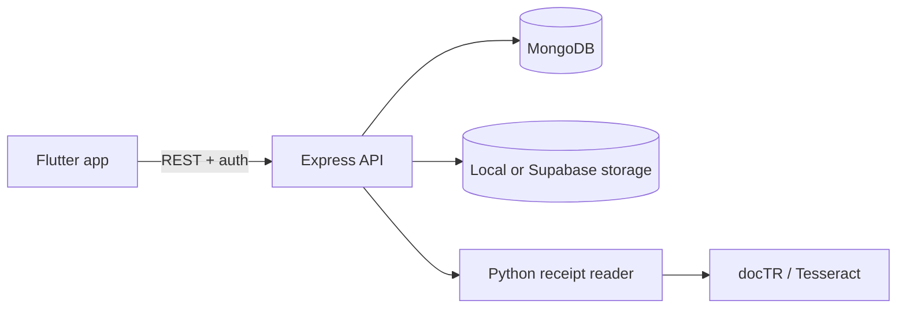

# Kharcha

> An open-source, self-hosted AI expense tracker built for **Frogtoberfest
> 2026**.

Kharcha solves a practical everyday problem: understanding where your money
goes without manually typing every receipt. Take a photo of a receipt and
Kharcha extracts the merchant, items, totals, and categories, then turns that
information into budgets, alerts, and spending insights.

This project is being developed as part of [Frogtoberfest
2026](https://frog.ly/frogtoberfest-2026), a month-long virtual challenge to
build an open-source, AI-powered product that solves something real. Kharcha
keeps the AI open and self-hosted: OCR and receipt classification run through
the project's own reader service rather than a proprietary AI API.

## Table of contents

- [What it does](#what-it-does)
- [Why Kharcha?](#why-kharcha)
- [AI and open-source approach](#ai-and-open-source-approach)
- [Project structure](#project-structure)
- [Technology](#technology)
- [Getting started](#getting-started)
  - [Prerequisites](#prerequisites)
  - [Start the backend](#1-start-the-backend)
  - [Start the receipt reader](#2-start-the-receipt-reader-optional)
  - [Run the Flutter app](#3-run-the-flutter-app)
  - [Docker Compose](#docker-compose)
- [Development commands](#development-commands)
- [Documentation](#documentation)
- [Contributing](#contributing)
- [License](#license)

## What it does

- Scan receipts with the phone camera and upload them for processing.
- Extract merchants, dates, totals, tax, discounts, line items, and categories.
- Review and correct receipt data before it affects spending reports.
- Track spending by month, category, and trend.
- Set category budgets and receive 80% and 100% usage alerts.
- Continue working with demo data and an offline upload queue when the backend
  is unavailable.
- Authenticate with Firebase, or use development-token authentication locally.

## Why Kharcha?

Expense tracking often fails because recording a purchase takes more effort
than the purchase itself. Kharcha is designed around a simpler flow:

```text
Photograph receipt -> Extract receipt data -> Review when needed -> Understand spending
```

The system uses confidence scores, arithmetic reconciliation, and a review
screen instead of silently presenting uncertain OCR results as fact. It also
learns from category corrections made by the user.

## AI and open-source approach

- **OCR:** docTR with Tesseract as a fallback, including English and Nepali
  receipt text.
- **Receipt parsing:** a project-trained scikit-learn model identifies store
  names, line items, totals, and related fields.
- **Categorization:** a project-trained TF-IDF and logistic-regression model
  assigns each line item to a spending category.
- **Safety:** confidence and reconciliation checks route uncertain receipts to
  review rather than guessing.
- **Privacy:** no proprietary AI API is required; the reader can run locally
  or alongside the backend with Docker.

Read the full [AI usage disclosure](AI_USAGE.md) for the model
pipeline and where its output affects application behavior.

## Project structure

```text
.
├── kharcha_app/       Flutter client
├── Kharcha-backend/   Node.js + Express + TypeScript API
├── reader/            Python OCR and receipt-understanding service
├── docker-compose.yml Local backend + reader services
└── .env.example       Shared Docker environment template
```



## Technology

| Area | Technologies |
| --- | --- |
| Mobile | Flutter, Dart, Riverpod, go_router, Dio, Firebase Auth |
| API | Node.js 22, Express, TypeScript, Mongoose, Zod |
| Database | MongoDB |
| Receipt reader | Python, FastAPI, docTR, Tesseract, scikit-learn |
| Storage | Local filesystem or private Supabase bucket |

## Getting started

### Prerequisites

- Flutter SDK with Dart 3.12 or later
- Node.js 22 or later
- MongoDB
- Python 3 and Tesseract OCR for the reader service
- Firebase project configuration for real authentication

### 1. Start the backend

```bash
cd Kharcha-backend
copy .env.example .env       # Windows
# cp .env.example .env       # macOS/Linux
npm install
npm run dev
```

The API is available at <http://localhost:4000>. For a quick local setup,
set `AUTH_MODE=dev` in `Kharcha-backend/.env`; this avoids Firebase Admin
credentials and accepts a development token.

### 2. Start the receipt reader (optional)

The application can run with `READER=manual`, so the reader is optional during
initial development.

```bash
cd reader
python -m venv .venv
# Windows:
.venv\Scripts\activate
# macOS/Linux:
# source .venv/bin/activate
pip install -r requirements.txt
uvicorn server:app --host 0.0.0.0 --port 8000
```

To connect it to the API, set these values in `Kharcha-backend/.env`:

```dotenv
READER=http
READER_URL=http://localhost:8000
```

### 3. Run the Flutter app

```bash
cd kharcha_app
flutter pub get
flutter run
```

The default `DEMO_DATA=true` mode displays sample data without requiring the
backend. To use the local API from an Android emulator:

```bash
flutter run --dart-define=DEMO_DATA=false --dart-define=API_BASE_URL=http://10.0.2.2:4000
```

The scanner also requires Android camera permission and `minSdkVersion 24`.
On iOS, add `NSCameraUsageDescription` to `Info.plist`.

### Docker Compose

Docker Compose starts the API and reader together:

```bash
copy .env.example .env       # Windows
# cp .env.example .env       # macOS/Linux
docker compose up --build
```

MongoDB is not included in the Compose file, so `MONGODB_URI` must point to a
running MongoDB instance.

## Development commands

### Flutter

```bash
flutter test
flutter analyze
```

### Backend

```bash
npm test
npm run typecheck
npm run build
```

### Reader

```bash
OCR_ENGINE=tesseract OCR_LANGS=eng python -m unittest discover tests -v
```

## Documentation

The root README is the project overview. Detailed documentation is kept next
to the component it describes:

- [Flutter app guide](kharcha_app/README.md)
- [Backend guide](Kharcha-backend/README.md)
- [API contract](Kharcha-backend/docs/api-contract.md)
- [Reader service guide](reader/README.md)
- [AI usage disclosure](AI_USAGE.md)
- [Environment template](.env.example)
