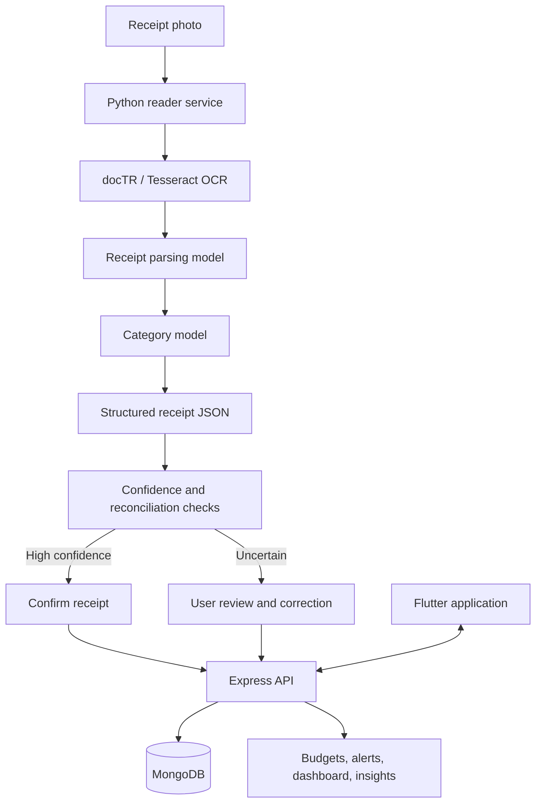

<div align="center">

# KHARCHA
### Open-source AI expense tracking for everyday receipts

[](https://flutter.dev/)
[](https://dart.dev/)
[](https://nodejs.org/)
[](https://www.python.org/)
[](LICENSE)

**Frogtoberfest 2026 · AI-FORGE-2026**

</div>

---

Kharcha answers a simple question: **where did my money go, without making me
type every receipt?**

Take a photo of a receipt and Kharcha extracts the merchant, date, totals,
line items, and categories. The application then uses that structured data for
budgets, alerts, dashboards, and spending insights. Uncertain results are
sent to a review flow instead of being silently accepted.

Kharcha is built for [Frogtoberfest
2026](https://frogtoberfest.lftechnology.com/) as an open-source,
self-hosted AI product solving a real problem for everyday spending,
including English and Nepali receipts.

## Contents

- [Why Kharcha](#why-kharcha)
- [Use cases](#use-cases)
- [How it works](#how-it-works)
- [AI usage](#ai-usage)
- [Technology](#technology)
- [Prerequisites](#prerequisites)
- [Setup](#setup)
- [Quick start](#quick-start)
- [Running each service](#running-each-service)
- [Testing](#testing)
- [Limitations and future work](#limitations-and-future-work)
- [Documentation](#documentation)
- [Contributing](#contributing)
- [License](#license)

## Why Kharcha

Recording expenses manually is repetitive enough that people stop doing it.
Kharcha makes the receipt itself the starting point:

```text
Photograph receipt -> Extract data -> Review when needed -> Understand spending
```

The product is designed to reduce friction while keeping the user in control:

- Receipt photos become editable structured records.
- Confidence and arithmetic checks identify readings that need attention.
- Category corrections can guide later receipt processing.
- Budgets and alerts turn raw transactions into useful decisions.
- Demo data and an offline upload queue make the core experience easy to show.

## Use cases

### Everyday spending

Capture a receipt once and get a searchable record of what was purchased,
where, and for how much.

### Budget awareness

Set category limits and see when spending reaches 80% or 100% of a budget.

### Nepali and English receipts

The reader supports English and Nepali OCR configurations and is designed for
the receipts people encounter locally.

### Private, self-hosted processing

Run the reader locally instead of sending receipt images to a proprietary
hosted AI API.

## How it works



The AI output is not just displayed to the user. It is parsed into typed data,
validated, mapped to user categories, persisted, and used to route the receipt
through confirmation or review.

## AI usage

Kharcha uses open and self-hosted AI components throughout its receipt
pipeline:

| Stage | Component | Product action |
| --- | --- | --- |
| Text extraction | docTR with Tesseract fallback | Converts receipt images into text lines |
| Line parsing | Project-trained scikit-learn model | Identifies merchants, items, totals, and fields |
| Categorization | TF-IDF + logistic regression model | Assigns each item to a spending category |
| Validation | Confidence and arithmetic checks | Routes the receipt to confirmation or review |

The complete file- and function-level disclosure is in
[AI_USAGE.md](AI_USAGE.md).

## Technology

| Area | Technologies |
| --- | --- |
| Mobile client | Flutter, Dart, Riverpod, go_router, Dio |
| Authentication | Firebase Auth or local development-token mode |
| API | Node.js 22, Express, TypeScript, Zod |
| Database | MongoDB with Mongoose |
| Receipt reader | Python, FastAPI, docTR, Tesseract, scikit-learn |
| Storage | Local filesystem, in-memory tests, or private Supabase bucket |
| Testing | Jest, Supertest, Python unittest, Flutter test, Flutter analyzer |

## Prerequisites

- Flutter 3.44+ with Dart 3.12+
- Node.js 22+
- Python 3.13+ and Tesseract OCR
- MongoDB for the full backend
- Firebase project configuration for production authentication
- Docker Desktop is optional for the reader/backend Compose workflow

## Setup

```bash
git clone https://github.com/shaleen2062-sys/Kharcha.git
cd Kharcha
```

Create the backend environment:

```powershell
cd Kharcha-backend
copy .env.example .env
```

For local development without Firebase Admin credentials, set
`AUTH_MODE=dev` in `Kharcha-backend/.env`. Set `MONGODB_URI` to a running
MongoDB instance.

## Quick start

The Flutter client starts in demo mode by default, so the product experience
can be explored without a running backend:

```powershell
cd kharcha_app
flutter pub get
flutter run
```

To connect an Android emulator to the local API:

```powershell
flutter run --dart-define=DEMO_DATA=false --dart-define=API_BASE_URL=http://10.0.2.2:4000
```

## Running each service

### Backend API

```powershell
cd Kharcha-backend
npm install
npm run dev
```

Health check: <http://localhost:4000/api/health>

### AI reader

```powershell
cd reader
python -m venv .venv
.venv\Scripts\activate
pip install -r requirements.txt
uvicorn server:app --host 0.0.0.0 --port 8000
```

For a smaller Tesseract-only installation, use
`requirements-lite.txt` and set `OCR_ENGINE=tesseract`.

Reader documentation: <http://localhost:8000/docs>

To connect the backend to the reader, set the following in
`Kharcha-backend/.env`:

```dotenv
READER=http
READER_URL=http://localhost:8000
```

### Docker Compose

```powershell
copy .env.example .env
docker compose up --build
```

Compose starts the backend and reader. MongoDB must be provided separately
and configured through `MONGODB_URI`.

## Testing

```powershell
# Flutter
cd kharcha_app
flutter analyze
flutter test

# Backend
cd ..\Kharcha-backend
npm run typecheck
npm test
npm run build

# Reader
cd ..\reader
python -m unittest discover -s tests -p "test*.py" -v
```

## Limitations and future work

Kharcha is an active Frogtoberfest project. Current limitations are useful
directions for contributors:

| Limitation | Future improvement |
| --- | --- |
| Receipt accuracy depends on image quality and printed layouts | Expand training data and add more receipt-layout evaluation |
| Handwritten and very blurry receipts may require manual entry | Improve readability detection and review assistance |
| The reader currently focuses on English and Nepali configurations | Add more local languages and receipt formats |
| MongoDB and Firebase setup are still required for the full production path | Provide a simpler self-hosted deployment profile |
| The upload queue is local to the device | Add durable sync conflict handling and retry observability |
| No hosted demo is included in this repository | Publish a safe demo environment and a short walkthrough video |
| Mobile native scanner setup requires camera permissions and platform config | Add a release checklist and automated platform smoke tests |

## Documentation

- [Flutter app guide](kharcha_app/README.md)
- [Backend guide](Kharcha-backend/README.md)
- [API contract](Kharcha-backend/docs/api-contract.md)
- [Reader guide](reader/README.md)
- [AI usage disclosure](AI_USAGE.md)
- [Contribution guide](CONTRIBUTING.md)
- [Environment template](.env.example)

## Contributing

See [CONTRIBUTING.md](CONTRIBUTING.md) for the development workflow, testing
requirements, AI/data considerations, and pull request checklist.

## License

Kharcha is released under the [MIT License](LICENSE).
